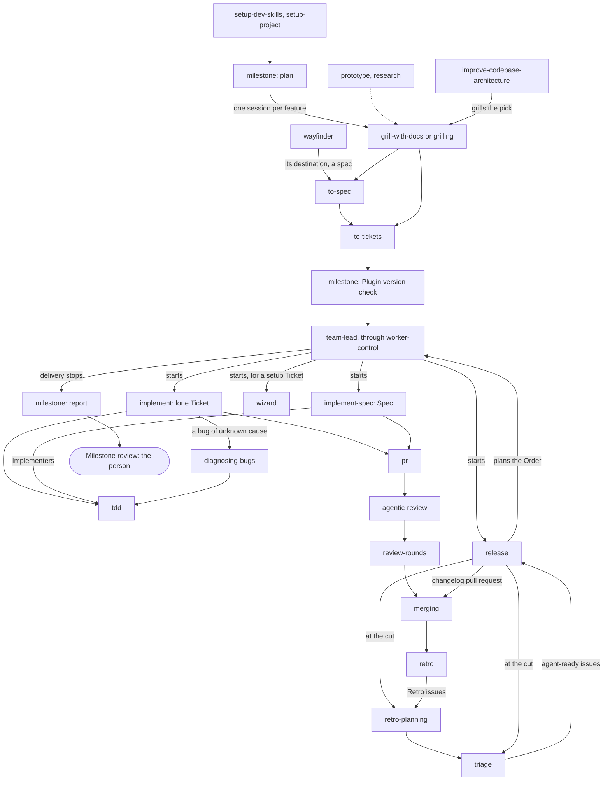

# ask-luffy

This skill answers questions about the workflow as a whole: the path from an idea to an accepted Milestone, who does each part, where the person steps in, and which skill hands to which. It holds the shape only. Every rule stays with the skill that owns it, named at each place below.

Before you say what one skill does or how, or that a step can be skipped, open that skill's `SKILL.md` and answer from it. The lines here are for orientation: where one disagrees with the skill it names, the skill is right. For "which skill for this", answer from the map below and the skill descriptions you already hold.

## Who does the work

- **The person** sets the goal, plans with an agent, answers what is put to them and accepts the Milestone.
- **The coordinator** is the session that runs delivery with `team-lead`, or, where it cannot load the skills, with the project instructions `setup-project` writes for it. It starts threads and reads what they report; it builds nothing.
- **A thread** is one worker session with one job: a planning session, a Release thread, a build thread for one Spec or lone Ticket, a guiding thread for a setup step.
- **A subagent** is started by a thread for a narrow task: an Implementer on one Ticket, a Finder or the Verifier of a review, a cheap job such as a test run.

## The process

Every plan is a Milestone; a small Release is a Milestone with one Release.

0. **Set up the repo** (person, with an agent): `setup-dev-skills` writes the docs the other skills read, the Boundary record and the release doc among them; `setup-project` writes the coordinator's instructions.
1. **Plan the Milestone** (person, with a planning session): with `milestone`, the person sets the goal and names the features, and the session sorts them into a dependency graph.
2. **Plan each feature** (person, with one session per feature): `grill-with-docs` (`grilling` with no repo) sharpens it; `to-spec` and `to-tickets` publish a Spec with its Tickets, or one lone Ticket. A foggy effort is charted first with `wayfinder`; a question that needs running code detours through `prototype`; `research` gathers sources. Once every feature is planned, the Milestone planning session writes the Milestone issue with the person.
3. **Check the plugin** (coordinator, or a worker it starts): `milestone`'s Plugin version check reads that threads load main's plugin text.
4. **Deliver** (coordinator): `team-lead` starts a Release thread, then build threads as their blockers close and takes every worker action through `worker-control`.
5. **Plan and cut each Release** (Release thread): `release` takes the next slice of the Milestone's features; once stage 6 has built them, it cuts the Release, runs `retro-planning` and `triage`'s Triage batch, and plans the next.
6. **Build** (build thread): `implement` builds a lone Ticket itself; `implement-spec` coordinates Implementer subagents, one per Ticket, onto one Spec branch. The code is built with `tdd`; the pull request is written with `pr`, reviewed with `agentic-review` (whose Rounds `review-rounds` runs), merged with `merging`, and the thread ends with `retro`.
7. **Report** (coordinator, or a thread it starts): once delivery stops, `milestone` writes the Milestone report.
8. **Accept** (person): the Milestone review. The person accepts it, sends a feature back or lifts a park.

Stages 5 and 6 repeat for each Release. Work that arrives raw joins on the way: an incoming issue goes through `triage`; a bug whose cause is unknown is diagnosed with `diagnosing-bugs` before its fix is built (`implement`); `improve-codebase-architecture` surfaces refactors and grills the one the person picks.

## Where the person steps in

Every repo has these points:

- **Planning**: the Milestone's goal, features, graph, acceptance and exclusions with `milestone`, and each feature's session (`to-tickets` publishes nothing before the person approves the breakdown).
- **A setup Ticket**: an account, product or credential only the person can provide. `to-tickets` files it, and a guiding thread runs `wizard` with the person (`team-lead`); only the work it blocks waits.
- **A failed Plugin version check** at the Milestone's start: delivery waits for the person's word (`milestone`).
- **A decision a thread cannot make**: a parked issue waits for the person's answer, and an action only the person can take is asked once while other work goes on (`implement`, `implement-spec`, `team-lead`). An enhancement an agent found waits for the person at `ready-for-human` (`triage`).
- **The Milestone review**: only the person accepts the Milestone (`milestone`).

Everything else is the repo's own choice. When you answer, read the repo's Boundary record (`docs/dev-skills/boundaries.md`), its release doc (`docs/dev-skills/release.md`), and any rule in its `CLAUDE.md`, `AGENTS.md` or project instructions that says a person merges or decides something, then say which points apply here and quote the line each comes from. With no Boundary record or release doc, say so and point to `setup-dev-skills`.

## How the skills fit together

Each arrow is a hand-off: the skill at its tail loads, starts or feeds the one at its head.

The other skills are references that a stage loads rather than stages: `domain-modeling` and `codebase-design` for vocabulary, `model-tiers` for which model runs a tier, `review-record` and `issue-absorption` for record formats, `docs-index` for the docs index, `writing-for-agents` for skill text, and `handoff` to carry work to a fresh session.

Within one session, at the gap between two phases of work, [PHASE-BOUNDARIES.md](PHASE-BOUNDARIES.md) says whether to continue, clear, hand off, send a subagent or compact.

## Answering

Match the question. "How does development work": the stages with who does each. "When am I needed": the points above, then this repo's own, each with the line it comes from. "How do the skills fit together": the map, rendered where the reader can see it. Name the skill that owns each step, so the person knows where the rule lives.
