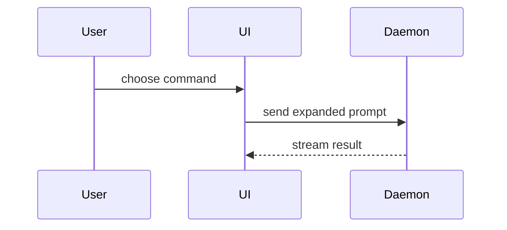

## Title

Write the title as `<type>: <summary>` (Conventional Commits). An optional scope goes after the type: `<type>(<scope>): <summary>`. The type is one of `feat`, `fix`, `docs`, `chore`, `refactor`, `test`. Pick it by what the change does: new behaviour `feat`, a fix `fix`, docs only `docs`, tooling and housekeeping `chore`, no behaviour change `refactor`, tests only `test`. A breaking change puts `!` after the type (or scope): `feat!: <summary>`. The summary is one short line in the imperative. The title becomes the commit title on main, so it must make sense read alone in the history.

If the repo's own rules (its `CLAUDE.md`, `AGENTS.md` or docs) set another title convention, follow that one instead.

## Body

Use this template for writing the PR body:

```markdown
## Summary

<diagram, diff-sketch, or tree>

## Evidence

- **Tests:** <the exact test that fails before and passes after, or what was checked instead>
- **Checks:** <typecheck output, or the repo's checks (lint, validate script)>
- **Screenshots:** <before and after for anything visual, or "not visual", or why not captured>

<a spec's PR: repeat these bullets per ticket, under the ticket's number; else delete this line>

## Closes

<one `Closes #<n>` per issue the pull request closes, one per line; delete this section if it closes none>

## Merge Danger

**Door:** <one-way or two-way; a spec's PR: one-way (#a, #b) if any ticket is>

<if one-way: one line on what a revert would not undo; else delete this line>

**Blast Radius:** <one-word description>

<optional: potential ramifications of merge>
```

## Sections

Skip all preambles and keep prose brief. Use the user's domain language from the glossary: start at `docs/dev-skills/index.md` and open only the docs that fit (with no index, fall back to `docs/dev-skills/glossary.md` and `docs/dev-skills/adr/`).

### Summary

Pick the smallest view that makes the key point clear.

- Show logic or an algorithm as pseudocode:

```text
on(save)
  if content is unchanged
    return cached result
  write new content
  return fresh result
```

- Show runtime control flow as a call tree:

```text
submitForm
  createSession
    persistPrompt
    launchAgent
  navigateToSession
```

- Show UI structure as a component tree, including state and module boundaries that matter:

```text
<SessionPage> (apps/example/src/routes/session.tsx)
  useSessionEvents()
  <SessionToolbar>
    <RunSkillButton> (packages/ui)
```

- Show file responsibility or a broad refactor as a shallow file tree:

```text
src/
├── commands/       # parses user actions
├── sessions/       # owns session state
└── transport/      # sends API requests
```

- Show component interaction, control flow, or data flow with Mermaid:



- Use `diff` when the point is what changes and the surrounding shape already exists. Match the diff shape to the topic.

For a component change:

```diff
 <SessionPage>
   useSessionEvents()
   <SessionToolbar>
+    <RunSkillButton />
   <SessionTimeline>
+    <SkillResultCard />
```

For a file-layout change:

```diff
 src/
 ├── commands/
+│   └── show-me.ts       # expands the slash command
 ├── sessions/
-└── transport.ts
+└── transport/
+    ├── client.ts
+    └── stream.ts
```

For a call-tree or call-stack change:

```diff
 submitForm
   createSession
     persistPrompt
+    expandSkillMention
     launchAgent
-  navigateToSession
+  navigateToSession
+    subscribeToEvents
```

For a state or control-flow change:

```diff
 on(save)
-  write content
+  if content is unchanged
+    return cached result
+  write new content
+  invalidate cache
```

- Show the whole block when most of it is new, when omitted context would hide ownership or order, or when the user needs a copyable target shape:

```ts
function expandSkill(command: string): string {
  const skillName = command.slice(1);
  return `use the ${skillName} skill`;
}
```

#### Guidance

Place each visual next to the short text it supports. Keep only the calls, files, props, states, and boundaries needed to answer the user's current question or the options to resolve the current discussion point.

You may use one of these, you may use several, it is unlikely you will use all of them. Use your judgement and don't overwhelm the user.

### Evidence

Concrete evidence that the change works: what failed before now passes.

Screenshots are S-tier - for anything visual. If the environment can't take them, say so.

Execution-based evidence is A-tier. Test results, console output. Show the exact test that fails before and passes after, using pseudocode. Include the typecheck output, or the output of the repo's checks (a lint or validate script).

When something can't be shown (a docs-only change has no tests), say what was checked instead; never leave an Evidence line empty.

A PR that collects several tickets (a spec's PR) carries each ticket's evidence into its body.

### Closes

GitHub's closing keyword applies only to the one issue number right after it, so `Closes #1, #2, #3` closes at most `#1`. Write one keyword per issue, one per line:

```markdown
Closes #1
Closes #2
Closes #3
```

A spec's PR lists the spec and every ticket that has landed on its branch, not every ticket (a dropped or never-landed ticket stays out, or merging closes it as completed); for absorbed sources, load `issue-absorption` and apply its closing-line agreement.

### Merge Danger

Describe whether it's a one-way or two-way door. You can walk back through two-way doors, but not one-way doors. A PR that is cheap to roll back is lower risk. Changes that involve destructive actions or hard-to-reverse decisions are one-way doors.

Decide with one test: would reverting the PR's commits undo everything the change did, including anything outside git? If not, it is a one-way door. For example: a data migration, deleted data, a public interface others depend on, a message sent outside the project, a published release. A version bump merged with the PR, where each pull request bumps the version, is not a published release: a revert walks it back with the next version number. Mark it plainly as `**Door:** one-way`, with one line on what a revert would not undo, so a reader or merging agent can find it. The repo's Boundary record decides whether its merging thread may merge a one-way door itself (the build skills' merge step).

A PR that collects several tickets (a spec's PR) carries each ticket's Door call into its body, and is one-way if any ticket's Door is, naming those tickets.

The blast radius is the potential impact or scope of the changes introduced by this PR. Consider all possibilities. Examples are layout shift, breakages for consumers, mobile responsiveness, etc.
